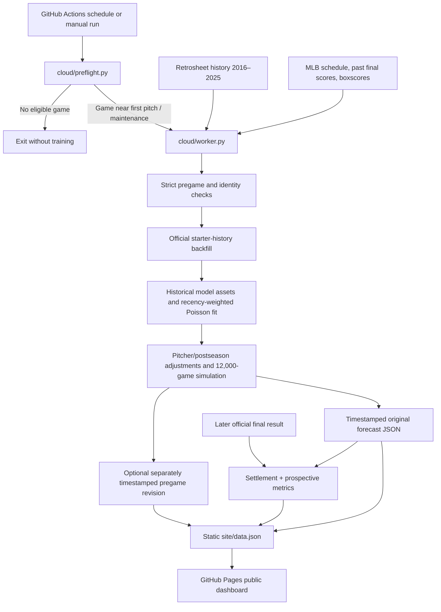

# System architecture

## Overview

MLB Forecast Lab is a batch-forecasting pipeline rather than a continuously running server. GitHub Actions performs the expensive work; GitHub Pages only serves the generated HTML and JSON.

## Production components

| File/folder (inside `MLB_Forecast_Lab_Cloud_Automation_COMPLETE`) | Responsibility |
|---|---|
| `cloud/preflight.py` | Cheap, standard-library schedule check before launching the expensive job. |
| `cloud/worker.py` | Acquires inputs, checks game status and time, builds assets, saves pregame records, later settles finals and renders the site. |
| `cloud/refresh.py` | Refreshes official completed games with date cutoffs and atomic writes; rejects contradictory game identities. |
| `cloud/history_bootstrap.py` | Retrieves missing Retrosheet game-log archives from 2016–2022. |
| `cloud/starter_backfill.py` | Finds verified older starts for the scheduled pitchers and excludes games on/after the forecast date. |
| `v4_matchup_core.py` | Fits the regular-season Poisson regression with historical recency weights. |
| `v4_workflow.py` | Builds game-level run expectations from available baseball context. |
| `v4_simulation.py` | Samples game scores from run expectations and derives probabilities. |
| `v62_pitching.py`, `v63_postseason.py` | Optional pitcher-specific and postseason-context adjustments. |
| `site/index.html`, `site/data.json` | Browser-facing presentation and generated forecast JSON. |

## Scheduling and time integrity

- Repository workflow: `.github/workflows/mlb-cloud.yml`, using the `master` branch.
- Lightweight GitHub Actions gate: `*/5 * * * *` (every five minutes, **best effort**), plus a daily maintenance invocation at 11:17 UTC.
- The gate looks for games approximately 16–31 minutes before first pitch. The worker performs an independent eligibility check in an 8–30-minute window.
- Network or GitHub delays can cause missed forecasts; an after-start game is **not** treated as a legitimate pregame observation.
- MLB game type, start time and scheduled status are checked, and a forecast is stamped in UTC with its actual run time.

GitHub Actions is not a real-time scheduler. The project must display lateness, missing data and last update time, and should not imply guaranteed execution exactly 20 minutes ahead.

## Persistence design

- `cloud_records/predictions/<game_id>.json`: original prediction. If it exists, a normal run will not overwrite it.
- `cloud_records/revisions/<game_id>_<timestamp>.json`: explicitly requested second **pregame** forecast; the original remains intact, and both can appear on the website.
- `cloud_records/revision_requests/`: explicit one-time requests checked for game identity and before-first-pitch eligibility.
- `cloud_records/last_run.json`: maintenance and forecast-run status.
- `site/data.json`: rendered view of saved records, including comparisons when available.

The word *immutable* refers to the application's normal write policy; a Git repository administrator could still change historical files or rewrite Git history. Commit SHA, timestamps and stored comparison fields aid traceability but are not cryptographic guarantees against malicious editing.

## Why static hosting

This design requires no permanently running personal computer or website server, and produces an accessible read-only dashboard. The trade-offs are delayed scheduled jobs, possible missed game windows, and repository-based storage rather than an independently managed database.
